<p align="center">
  
</p>

<p align="center">
  <a href="https://github.com/ishandutta2007/Awesome-Awesome-Awesome"></a>
  <a href="https://discord.gg/jc4xtF58Ve"></a>
  <a href="https://github.com/ishandutta2007/Awesome-Sales-Pipeline-Forecasting-Win-Rate-Analyzers/stargazers"></a>
  <a href="https://github.com/ishandutta2007/Awesome-Sales-Pipeline-Forecasting-Win-Rate-Analyzers/network/members"></a>
  <a href="https://github.com/ishandutta2007/Awesome-Sales-Pipeline-Forecasting-Win-Rate-Analyzers/blob/main/LICENSE"></a>
  <a href="https://github.com/ishandutta2007/Awesome-Sales-Pipeline-Forecasting-Win-Rate-Analyzers/commits/main"></a>
  <a href="https://github.com/ishandutta2007/Awesome-Sales-Pipeline-Forecasting-Win-Rate-Analyzers/pulls"></a>
  <a href="https://github.com/ishandutta2007"></a>
</p>

---

# 🚀 Awesome Sales Pipeline Forecasting & Win-Rate Analyzers

> **The ultimate curated directory of Revenue Intelligence, Sales Pipeline Inspection, Quota Forecasting, and Deal Risk Scoring solutions — spanning enterprise SaaS category leaders and open-source machine learning repositories.**

Last updated: March 2026 📅

---

## 📖 Executive Summary & Scope

Accurate revenue forecasting and objective deal qualification have transitioned from retrospective spreadsheets to predictive, machine-learning-driven **Revenue Operations (RevOps)** platforms. Modern sales intelligence tools evaluate CRM stage histories, buyer engagement cadences, conversation transcripts (calls, video, email), and rep behavior patterns to:
- 🎯 **Predict Deal Win/Loss Probabilities:** Quantify slippage risk using MEDDIC, BANT, and buyer momentum signals.
- 📊 **Cascade Quotas & Reconcile Forecast Biases:** Eliminate sandbagging and unjustified optimism through historical commit reconciliation.
- 🎙️ **Leverage Conversation Intelligence:** Transcribe and analyze sales calls to surface hidden objections, budget hesitations, and competitor mentions.
- 🛡️ **Preserve Data Sovereignty:** Deploy self-hosted, open-source pipeline modeling frameworks to bypass per-seat SaaS costs while protecting customer PII and proprietary sales data.

---

## 📑 Table of Contents

- [🌐 Sector Overview & Market Dynamics](#-sector-overview--market-dynamics)
- [🏢 Enterprise & Mid-Market SaaS Platforms](#-enterprise--mid-market-saas-platforms)
- [💻 Open-Source Repositories & Machine Learning Frameworks](#-open-source-repositories--machine-learning-frameworks)
- [🧠 Architectural Building Blocks for Custom Stacks](#-architectural-building-blocks-for-custom-stacks)
- [🤝 How to Contribute](#-how-to-contribute)
- [📈 Star History](#-star-history)
- [💖 Support & Community](#-support--community)
- [📜 Disclaimer](#-disclaimer)

---

## 🌐 Sector Overview & Market Dynamics

The global **Revenue Intelligence and Sales Forecasting** software market is valued at approximately **$3.8 Billion to $5.5 Billion**, projected to expand at an 11.3%–12.0% CAGR toward **$10.7 Billion+** as enterprise go-to-market teams replace legacy BI dashboards with agentic, autonomous execution workflows. The broader sales analytics and pipeline management sector commands an addressable footprint exceeding **$11.6 Billion**.

```
┌────────────────────────────────────────────────────────────────────────┐
│                        MARKET STRUCTURE DYNAMICS                       │
├───────────────────────────────────┬────────────────────────────────────┤
│ 🏰 Concentrated Top Tier          │ 🧩 Fragmented Innovation Fringe   │
│ (Winner-Take-Most Core)           │ (Point Solutions & Open Source)   │
├───────────────────────────────────┼────────────────────────────────────┤
│ • Gong ($7.25B) & Clari ($2.6B)   │ • Specialized conversation AI      │
│ • Salesforce/Slack (Troops)       │ • Battlecards & competitive intel  │
│ • Fullcast (Atrium)               │ • Self-hosted Python/R ML engines  │
│ • Mediafly (InsightSquared)       │ • Open-source pipeline CRMs        │
└───────────────────────────────────┴────────────────────────────────────┘
```

The sector exhibits **moderate consolidation at the top** alongside **high structural fragmentation across operational niches**. Market leaders such as Gong and Clari dominate the large-enterprise core through multi-product platform consolidation (forecasting + conversation AI + engagement), and established CRM incumbents frequently acquire specialized workflow tools (e.g., Salesforce acquiring Troops, Mediafly acquiring InsightSquared, Fullcast acquiring Atrium). 

However, steep per-seat enterprise licensing fees ($1,200 to $1,800+ per rep annually) and proprietary black-box scoring algorithms have fueled rapid fragmentation in the mid-market and open-source developer ecosystems. Engineering teams are increasingly adopting self-hosted Python frameworks, custom DAG org-quota models, and local LLM conversation transcribers to maintain direct governance over their pipeline analytics.

---

## 🏢 Enterprise & Mid-Market SaaS Platforms

The following platforms represent the leading commercial Revenue Intelligence and Pipeline Forecasting suites. The table is **sorted descending by company size** (market capitalization, private valuation, or institutional funding).

| 🏢 Platform / Solution | 💰 Company Size (Valuation / Revenue) | 🏷️ Starting Tier Pricing | 🎁 Free Tier / Trial Limit | ⚡ Key Capabilities & Highlights |
| :--- | :--- | :--- | :--- | :--- |
| **[Troops](https://www.troops.ai/)** *(Salesforce)* | **~$280 Billion** *(Parent Market Cap; Acquired 2022; $19.4M Prior VC)* | **$19/user/month** *(Legacy standalone);* **$60/user/month** *(Salesforce Sales Elevate / Slack)* | **30-day free trial** *(via Salesforce Sales Cloud; full workflow alerts & CRM sync for up to 10 users, no CC required)* | Real-time deal pipeline inspection delivered natively into Slack and Microsoft Teams, automated CRM hygiene alerts, and multi-channel deal risk triggers. |
| **[Gong](https://www.gong.io/)** | **$7.25 Billion** *(Peak Valuation; $4.5B Secondary; $500M ARR)* | **$100–$140/user/month** *(Billed annually, $1,200–$1,600/user/yr) + mandatory base platform fee from $5,000/yr* | **14-day guided proof-of-concept pilot** *(Available to qualified enterprise sales teams following custom demo & CRM sync)* | Category leader in conversation intelligence, AI deal boards, buyer signal tracking, and multi-tier revenue forecasting roll-ups. |
| **[Clari](https://www.clari.com/)** | **$2.6 Billion** *(Series F Valuation; ~$150M ARR)* | **$100–$120/user/month** *(Billed annually, $1,200–$1,440/user/yr) + base platform fee ($5,000–$10,000/yr)* | **14 to 30-day enterprise sandbox evaluation** *(Tailored proof-of-concept pilot provided upon sales qualification)* | Predictive revenue forecasting engine, pipeline inspection, revenue leak diagnosis, and AI copilot deal execution analytics. |
| **[Klue](https://klue.com/)** | **$248 Million** *(Series B Valuation; $81M Raised; ~$25M ARR)* | **$1,250/month** *(Billed annually at $15,000/yr base tier; includes 10 battlecards and 20 user seats)* | **14-day structured pilot** *(Available for qualified competitive enablement teams with custom battlecard setup)* | Competitive enablement platform tracking win-loss ratios against specific competitors, embedded battlecards, and CRM deal impact analytics. |
| **[Mediafly](https://www.mediafly.com/)** | **~$180 Million** *(Private Valuation; $60M Raised; Acquired InsightSquared)* | **$30–$60/user/month** *(Billed annually, $360–$720/user/yr; starting enterprise deployments average ~$38,000/yr)* | **14-day interactive value realization assessment** *(Custom CRM test sandbox evaluation available upon demo request)* | Revenue enablement suite unifying interactive value selling calculators, buyer content engagement tracking, and pipeline velocity dashboards. |
| **[BoostUp](https://www.boostup.ai/)** | **~$140 Million** *(Private Valuation; $35M+ Raised; ~$10.8M ARR)* | **$79/user/month** *(Billed annually, ~$948/user/yr; requires 10-seat minimum commitment)* | **14-day full-feature trial** *(Bi-directional Salesforce/HubSpot data sync enabled upon sales team qualification)* | RevBI platform delivering deal risk prediction, buyer sentiment scoring, forecast submission workflows, and historical roll-up tracking. |
| **[InsightSquared](https://www.insightsquared.com/)** *(Mediafly)* | **~$100 Million** *(Acquisition Valuation; $50M Prior VC; now Mediafly Intelligence360)* | **$79/user/month** *(Billed annually, ~$948/user/yr; entry-level packages start at ~$15,000/yr)* | **14-day guided proof-of-concept trial** *(Includes CRM historical data audit coordinated via Mediafly sales engineering)* | Algorithmic sales forecasting, rep performance benchmarking, stage duration tracking, and full-funnel conversion velocity analytics. |
| **[Atrium](https://www.atriumhq.com/)** *(Fullcast)* | **~$80 Million** *(Series A Valuation; $20M Raised; Acquired by Fullcast)* | **$50–$80/user/month** *(Billed annually, $600–$960/user/yr; minimum 10-rep threshold, packages start at ~$6,000/yr)* | **Free account tier** *(90-second CRM connection; up to 5 core KPI dashboards and automated rep anomaly alerts); 14-day trial for Pro* | Continuous data-driven sales management alerts, AE/SDR metric tracking, quota pacing anomaly detection, and automated 1-on-1 coaching plans. |
| **[Revenue.io](https://www.revenue.io/)** | **~$70 Million** *(Private Valuation; $44.5M Raised; ~$15M ARR)* | **$95/user/month** *(Activate tier, billed annually; Engage tier at $175/user/mo; minimum annual commitment ~$20,000)* | **Free tier on Revenue Roleplay** *(100 free AI roleplay sessions, no CC required); 14-day pilot for core CRM platform* | Salesforce-native conversation intelligence, real-time rep objection prompting, AI telephony dialer, and deal progression alerts. |
| **[Aviso](https://www.aviso.com/)** | **~$60 Million** *(Private Valuation; $46M Raised; ~$37M ARR)* | **$360/user/year** *(~$30/user/mo baseline seat; enterprise agentic packages start at $50,000/yr)* | **30-day proof-of-concept (PoC)** *(Includes backtesting against 2+ years of historical CRM data for qualified accounts)* | 98%+ accurate predictive forecasting, MIKI agentic revenue workflow coordinator, opportunity win-rate scoring, and what-if pipeline simulations. |

---

## 💻 Open-Source Repositories & Machine Learning Frameworks

The following open-source frameworks, CRM platforms, and machine learning repositories allow data science and revenue operations teams to build, self-host, and customize sales forecasting and deal risk modeling pipelines. 

The list is **sorted strictly descending by GitHub Stars_Count** ⭐. Every entry includes a social Stars_Badge linking directly to that repository's stargazers page:

1. **[Twenty](https://github.com/twentyhq/twenty)** [](https://github.com/twentyhq/twenty/stargazers)  
   Modern, extensible open-source CRM with visual sales pipeline management, custom opportunity stages, deal tracking, and revenue forecasting analytics. Built with TypeScript and React; provides full data autonomy and self-hosting capabilities.

2. **[SuiteCRM](https://github.com/SuiteCRM/SuiteCRM)** [](https://github.com/SuiteCRM/SuiteCRM/stargazers)  
   Enterprise-grade open-source CRM featuring end-to-end sales pipeline workflows, opportunity stage win-rate probabilities, rep quota monitoring, and detailed forecast reporting dashboards.

3. **[EspoCRM](https://github.com/espocrm/espocrm)** [](https://github.com/espocrm/espocrm/stargazers)  
   Lightweight, highly customizable open-source CRM featuring sales pipeline Kanban boards, deal stage weighted values, conversion rate tracking, and sales analytics reports.

4. **[Deep Learning for Time Series Forecasting](https://github.com/Alro10/deep-learning-time-series)** [](https://github.com/Alro10/deep-learning-time-series/stargazers)  
   Curated collection of research papers, code implementations, and benchmark architectures (LSTMs, Transformers, N-BEATS, Temporal Fusion Transformers) for predictive time-series and demand/revenue forecasting.

5. **[Walmart Sales Forecasting Solution](https://github.com/davidthaler/Walmart_competition_code)** [](https://github.com/davidthaler/Walmart_competition_code/stargazers)  
   The 1st-place Kaggle competition winning code for enterprise sales forecasting, featuring robust seasonal decomposition, holiday weighting, and multi-model ensemble regression.

6. **[sales_forecasting](https://github.com/mollyryanruby/sales_forecasting)** [](https://github.com/mollyryanruby/sales_forecasting/stargazers)  
   Production-oriented Python ML pipeline benchmarking 5 machine learning and statistical models (ARIMA, Linear Regression, Random Forest, XGBoost) to forecast sales volume and revenue.

7. **[Sales-Prediction](https://github.com/ROHANNAIK/Sales-Prediction)** [](https://github.com/ROHANNAIK/Sales-Prediction/stargazers)  
   Comprehensive retail and transactional sales forecasting engine modeling items, stores, and external macroeconomic indicators (fuel price, inflation, holiday calendars).

8. **[Horilla CRM](https://github.com/horilla/horilla-crm)** [](https://github.com/horilla/horilla-crm/stargazers)  
   Free and open-source enterprise CRM under LGPL-2.1+ with lead and deal pipelines, role-based access control, Swagger REST APIs, webhooks, and Docker Compose deployment.

9. **[sales-forecast-mlops-at-scale](https://github.com/jomariya23156/sales-forecast-mlops-at-scale)** [](https://github.com/jomariya23156/sales-forecast-mlops-at-scale/stargazers)  
   Full-stack, cloud-native MLOps architecture for continuous sales and demand forecasting with real-time streaming inference, automated data drift monitoring, and scheduled retraining loops.

10. **[Sales-Forecasting ARIMA](https://github.com/Akajiaku11/Sales-Forecasting)** [](https://github.com/Akajiaku11/Sales-Forecasting/stargazers)  
    Practical time-series sales forecasting workflow in Python demonstrating stationary testing, autocorrelation (ACF/PACF), ARIMA fitting, and revenue projection validation.

11. **[Meow](https://github.com/nash-md/meow)** [](https://github.com/nash-md/meow/stargazers)  
    Free sales pipeline management tool that gives teams a bird's-eye view of their entire funnel and automatically updates revenue forecasts as opportunities move down sales stages.

12. **[ml-forecast-features-eng](https://github.com/samirsaci/ml-forecast-features-eng)** [](https://github.com/samirsaci/ml-forecast-features-eng/stargazers)  
    Advanced feature engineering framework for machine learning sales forecasting, detailing lag variable creation, rolling window aggregates, trend extraction, and seasonality matrices.

13. **[product-sales-forecasting](https://github.com/akshitvjain/product-sales-forecasting)** [](https://github.com/akshitvjain/product-sales-forecasting/stargazers)  
    Comparative time-series forecasting suite using Holt-Winters, SARIMA, and regression models evaluated on MAE, RMSE, and MAPE benchmarks.

14. **[Sheety CRM](https://github.com/sdntsng/sheety-crm)** [](https://github.com/sdntsng/sheety-crm/stargazers)  
    Stateless, open-source CRM operating over Google Sheets, featuring pipeline stage management, deal opportunity tracking, and lightweight weighted revenue forecasting.

15. **[LeadGenius](https://github.com/Astoriel/LeadGenius)** [](https://github.com/Astoriel/LeadGenius/stargazers)  
    Open-source B2B lead scoring and routing engine. Designed as a self-hosted alternative to Clearbit and MadKudu with waterfall enrichment, customizable YAML scoring rules, and automated HubSpot/Slack notifications.

16. **[full-funnel-ai-analytics](https://github.com/eduardocornelsen/full-funnel-ai-analytics)** [](https://github.com/eduardocornelsen/full-funnel-ai-analytics/stargazers)  
    Full-funnel B2B AI analytics framework connecting marketing attribution, sales pipeline velocity, and conversion probability models.

17. **[ChurnGuard AI](https://github.com/ShreyasDasari/churnguard-ai)** [](https://github.com/ShreyasDasari/churnguard-ai/stargazers)  
    Self-hosted SaaS churn prediction using XGBoost and LightGBM with SMOTEENN resampling, PR-AUC evaluation, and revenue-weighted customer retention prioritization. Supports HubSpot, Stripe, and CSV imports.

18. **[AI-Driven CRM Analytics System](https://github.com/Isha2605/AI-Driven-CRM-Analytics-System)** [](https://github.com/Isha2605/AI-Driven-CRM-Analytics-System/stargazers)  
    Full-stack AI CRM featuring 82% lead classification accuracy across 10,000+ customer records using KNN + Feedforward Neural Networks, employee quota performance prediction, and a PyTorch chatbot.

19. **[CallSense](https://github.com/aaron-seq/ML-voice-lead-analysis)** [](https://github.com/aaron-seq/ML-voice-lead-analysis/stargazers)  
    Self-hosted conversation intelligence turning recorded sales calls into qualified leads with explainable 0–100 scores, 7 objection classifiers, 10 BANT/MEDDIC intent signals, and deal risk flags.

20. **[b2b-revenue-forecasting](https://github.com/shreyasrkarwa/Analytics)** [](https://github.com/shreyasrkarwa/Analytics/stargazers)  
    Specialized Python framework for enterprise B2B quota cascading via Directed Acyclic Graph (DAG) sales org hierarchies and `CommitReconciler` for fixing rep forecasting bias (sandbagging / over-committing). Available on [PyPI](https://pypi.org/project/b2b-revenue-forecasting/).

21. **[SalesIQ](https://github.com/badrr06/SalesIq)** [](https://github.com/badrr06/SalesIq/stargazers)  
    Modular Flask web app for sales management and forecasting. Includes KPI dashboards, product performance rankings, and monthly sales + 6-month ARIMA/SARIMAX revenue projections.

22. **[afrikana-analytics](https://github.com/Peterson-Muriuki/afrikana-analytics)** [](https://github.com/Peterson-Muriuki/afrikana-analytics/stargazers)  
    Production-ready analytics toolkit featuring Gradient Boosting churn scoring, survival-adjusted Customer Lifetime Value (CLV) calculation, and Monte Carlo revenue simulations. Available on [PyPI](https://pypi.org/project/afrikana-analytics/).

23. **[lead-scoring-ai-mcp](https://github.com/CSOAI-ORG/lead-scoring-ai-mcp)** [](https://github.com/CSOAI-ORG/lead-scoring-ai-mcp/stargazers)  
    Model Context Protocol (MCP) server for automated B2B lead scoring, engagement tracking (emails, demo requests, meetings), and conversion probability estimation. Available on [npm](https://www.npmjs.com/package/lead-scoring-ai-mcp).

---

## 🧠 Architectural Building Blocks for Custom Stacks

Organizations that choose to construct sovereign, self-hosted RevOps analytics platforms can combine these modular open-source layers:

```
┌────────────────────────────────────────────────────────────────────────┐
│                   SOVEREIGN REVOPS ARCHITECTURE STACK                  │
├────────────────────────────────┬───────────────────────────────────────┤
│ 1. CRM & Pipeline Core         │ Twenty / SuiteCRM / EspoCRM           │
│ 2. Quota & Hierarchical Models │ b2b-revenue-forecasting (Python DAG)  │
│ 3. Conversation Intelligence   │ CallSense (Local Audio Transcription) │
│ 4. Lead Scoring & Routing      │ LeadGenius / lead-scoring-ai-mcp      │
│ 5. Churn & Expansion Scoring   │ ChurnGuard AI / afrikana-analytics    │
│ 6. Time-Series Forecasters     │ ARIMA / Prophet / Deep Learning LSTM  │
└────────────────────────────────┴───────────────────────────────────────┘
```

- **Quota Reconciliation:** Combine **b2b-revenue-forecasting** to eliminate rep bias and enforce quota cascading across complex parent-child territory matrices.
- **Deal Health Extraction:** Integrate **CallSense** with local Whisper models to capture buyer objections without transmitting audio streams to third-party clouds.
- **Churn Mitigation:** Deploy **ChurnGuard AI** to compute retention risk prior to contract expiration windows.

---

## 🤝 How to Contribute

We welcome additions, corrections, and updates from the sales engineering, RevOps, and open-source data science communities! 💡

1. 🍴 **Fork the repository** on GitHub.
2. 📝 **Create a feature branch** (`git checkout -b feature/add-new-forecasting-tool`).
3. ✏️ **Add your entry** to either the SaaS table or the Open-Source section:
   - For **SaaS platforms**: Include platform name, company size/valuation, exact starting tier pricing, explicit free trial terms, and key capabilities.
   - For **Open-Source projects**: Include repository link, valid GitHub star social badge (`style=social&color=white`), and an objective description of the forecasting/analytics capabilities.
4. 📬 **Submit a Pull Request** with a clear explanation of why the tool belongs in this curated ecosystem.

---

## 📈 Star History

[](https://star-history.dera.page/#ishandutta2007/Awesome-Sales-Pipeline-Forecasting-Win-Rate-Analyzers&type=date&legend=top-left)

---

## 💖 Support & Community

If you find this curated sales forecasting ecosystem useful for your team or research, please consider supporting the project:
- ⭐ **Star this repository** to help other sales engineers and RevOps analysts discover it.
- 🍴 **Fork and share** with your network on LinkedIn, Twitter/X, and sales communities.
- ☕ **Sponsor or Buy a Coffee:** You can support continuous updates, benchmarks, and community curation via the [GitHub Sponsors Dashboard](https://github.com/sponsors/ishandutta2007).

Thank you to all contributors and revenue operations builders! 🙏

---

## 📜 Disclaimer

- This repository is a community-curated, independent educational resource and is not sponsored, endorsed, or affiliated with any commercial software vendors mentioned.
- Commercial SaaS pricing, contract minimums, and trial policies change frequently; always consult official vendor documentation for up-to-date commercial terms.
- Deployments incorporating automated call recording, conversational transcription, and PII lead scoring must comply with applicable data privacy regulations (e.g., GDPR, CCPA, wiretapping, and two-party consent laws).

---

<p align="center">
  <b>Built with ❤️ for Revenue Operations Teams, Sales Leaders, and Data Scientists.</b>
</p>
